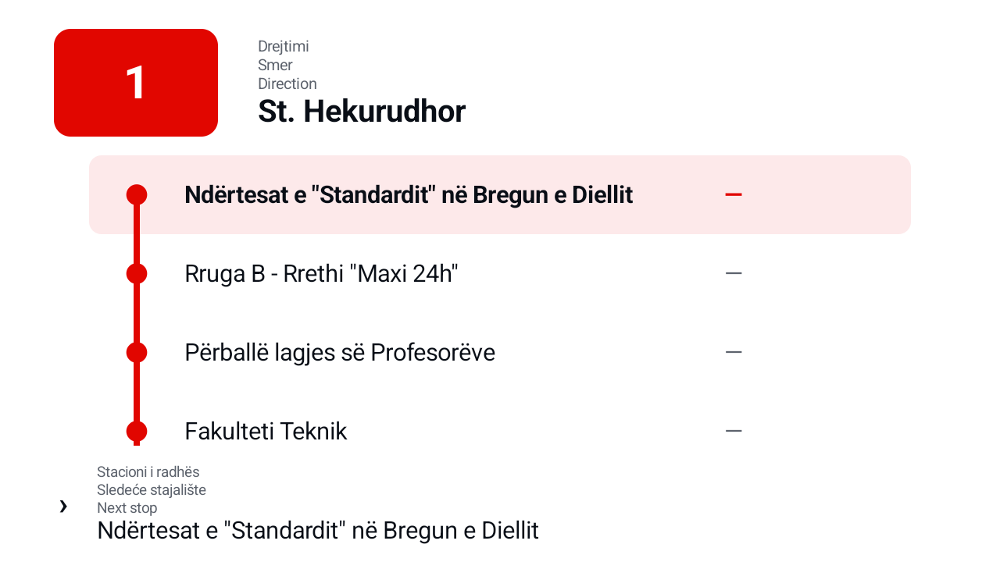
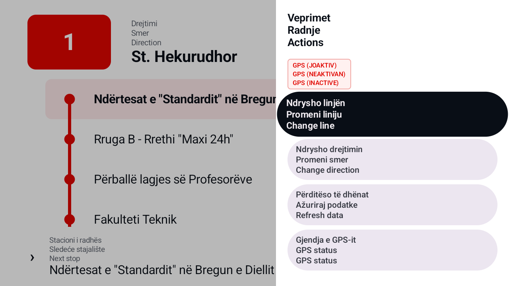

# Trafiku

Trafiku is an Android TV application for bus passenger information. It shows the selected line, direction, ordered stop sequence, current stop, next stop, and estimated arrival times. It also shows local image and video advertisements between route information periods.

The interface shows static passenger text in Albanian, Serbian in Latin script, and English. Each translation appears on a separate line. The application uses Jetpack Compose and supports D-pad input from an Android TV remote.

## Screenshots



<table>
  <tr>
    <td width="50%">
      
    </td>
    <td width="50%">
      
    </td>
  </tr>
  <tr>
    <td align="center"><strong>Remote actions</strong></td>
    <td align="center"><strong>Advertisement playback</strong></td>
  </tr>
</table>

## Features

- Select one bus line and one direction.
- Restore the selected route after an application restart.
- Download the Trafiku Urban network snapshot from a configurable server.
- Keep Room as the source of truth for offline route data.
- Refresh network data after a 24-hour time to live.
- Let the operator force a network refresh.
- Use device Global Positioning System (GPS) data first.
- Use a Universal Serial Bus (USB) National Marine Electronics Association (NMEA) receiver as a fallback.
- Simulate route travel in debug builds.
- Show local advertisements from `DCIM/TrafikuAds/`.
- Support image advertisements and muted video advertisements.

## Technology

- Kotlin and coroutines
- Jetpack Compose for TV
- Room
- DataStore
- Retrofit and Kotlin serialization
- Media3
- Android MediaStore
- USB serial communication

## Requirements

- Java Development Kit (JDK) 17
- Android Studio with the Android 16 Software Development Kit (SDK)
- Android application programming interface (API) level 36 or later
- The `Television_720p` Android Virtual Device (AVD) for emulator checks

Do not use the `Small_Phone` AVD for this project.

## Build the application

Clone the repository. Then run these commands from its root directory:

```text
./gradlew test
./gradlew lint
./gradlew assembleDebug
```

The debug APK is written to:

```text
app/build/outputs/apk/debug/app-debug.apk
```

Install the debug APK on a connected device:

```text
./gradlew installDebug
```

## Configure the server

The debug build uses this address:

```text
http://10.0.2.2:8080/
```

This address routes from the Android emulator to `localhost` on the development computer.

Set the release server address with the `trafiku.server.baseUrl` Gradle property. Include the final slash.

```text
./gradlew assembleRelease \
  -Ptrafiku.server.baseUrl=https://example.com/
```

The application requests this endpoint:

```text
GET api/bus-network/trafiku_urban/snapshot
```

## Configure signed releases

Create one release keystore. Keep the keystore and its passwords outside this repository. Keep a secure offline backup because future updates must use the same signing key.

Add these GitHub Actions secrets:

- `RELEASE_KEYSTORE_BASE64`: The Base64-encoded keystore file.
- `RELEASE_KEYSTORE_PASSWORD`: The keystore password.
- `RELEASE_KEY_ALIAS`: The signing key alias.
- `RELEASE_KEY_PASSWORD`: The signing key password.

Add this GitHub Actions repository variable:

- `TRAFIKU_SERVER_BASE_URL`: The release server base URL with a final slash.

The Android continuous integration workflow runs tests, lint, and a debug build for each branch push and pull request. It uploads the debug APK as a workflow artifact.

Push a tag that starts with `v` to start a signed release build:

```text
git tag v1.0.0
git push origin v1.0.0
```

The release workflow validates its configuration, runs tests and lint, builds an optimized signed APK, verifies the APK signature, and uploads the APK as a workflow artifact. A missing secret or repository variable stops the build with a clear error.

## Add or change translations

Add every static passenger message to all three locale files:

- `app/src/main/res/values-sq/strings.xml`
- `app/src/main/res/values-b+sr+Latn/strings.xml`
- `app/src/main/res/values-en/strings.xml`

Keep Albanian first, Serbian second, and English third. The shared trilingual resolver reads the three locale resources and joins them with newline characters. Do not translate route names or stop names that the server supplies.

## Install advertisements

Copy JPEG, PNG, WebP, MP4, or WebM files to this device directory:

```text
/sdcard/DCIM/TrafikuAds/
```

The application sorts files by name. It shows route information for 30 seconds. It then shows one image for 20 seconds or one muted video until playback ends.

See [Example advertisements](sample-ads/README.md) for installation commands.

## Project structure

```text
app/src/main/java/com/pelajstudios/trafiku/
├── data/             Data sources, repositories, models, and location processing
├── di/               Application dependency container
└── ui/               Application, route, advertisement, and theme code
```

Room supplies the stored bus network. The repository refreshes that data from the server. The user interface observes repository and location state through screen-level state holders.

## Documentation

- Read [Architecture](docs/ARCHITECTURE.md) for the application structure and data flows.
- Read [Deployment and operation](docs/DEPLOYMENT.md) for device, GPS, advertisement, and remote setup.
- Read [Development instructions](AGENTS.md) before you change the project.
